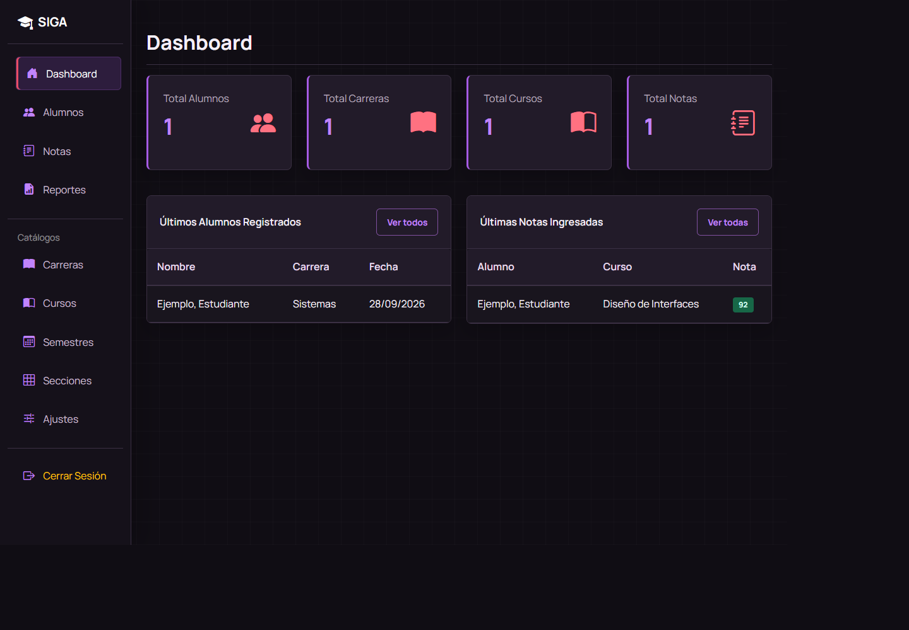

# SIGA — Sistema Integral de Gestión Académica

Aplicación web en PHP para administrar alumnos, carreras, cursos, semestres, secciones, calificaciones y reportes.

## Funciones principales

- Registro, consulta, búsqueda y actualización de alumnos con fotografía opcional.
- Administración de cursos, carreras, semestres y secciones.
- Registro de calificaciones e historial académico.
- Reportes filtrables con exportación a CSV y documento compatible con Word (`.doc`).
- Cuentas con roles de administrador y usuario normal.
- Interfaz adaptable a escritorio y dispositivos móviles, en español e inglés.

## Requisitos

- PHP 8.1 o posterior con `pdo_mysql`, `mbstring` y `fileinfo`.
- MySQL 8.0.16 o posterior.
- Composer.

## Instalación rápida en Ubuntu

Desde la raíz del proyecto:

```bash
sudo apt update
sudo apt install php-cli php-mysql php-mbstring php-xml php-curl php-zip mysql-server composer
composer install
cp .env.example .env
```

Edita `.env` y define las credenciales de MySQL. La contraseña en `DB_PASS` debe coincidir con la configurada para `sistema_app` en el script SQL.

Para una **base nueva** (el script elimina y vuelve a crear `sistema_academico`), importa el esquema y los datos iniciales:

```bash
sudo mysql < sql/sistema_academico_final.sql
```

Si MySQL está configurado para autenticar `root` con contraseña en lugar de `sudo`, usa `mysql -u root -p < sql/sistema_academico_final.sql`.

Para conservar una base existente, no ejecutes el script final. Aplica la migración de usuarios:

```bash
sudo mysql sistema_academico < sql/migrate_users.sql
```

En ambos casos, crea el primer administrador de la aplicación:

```bash
php create-admin.php
```

El asistente solicita nombre, correo y contraseña (mínimo 12 caracteres). Las cuentas adicionales se administran desde **Ajustes**.

Inicia el servidor de desarrollo desde `public/`:

```bash
cd public
php -S localhost:8000
```

Abre <http://localhost:8000>. Para Apache o Nginx, configura `public/` como raíz del sitio.

## Capturas



También hay capturas de [administración de cuentas](docs/screenshots/ajustes-cuentas.png) y [preferencias de idioma](docs/screenshots/ajustes-idioma.png).

## Roles y permisos

- **Administrador:** acceso a la gestión de alumnos, notas, catálogos y cuentas, incluyendo eliminaciones permanentes.
- **Usuario normal:** acceso al dashboard de estadísticas y a la consulta/descarga de reportes. No tiene acceso a las pantallas de gestión.
- La autorización se comprueba en el servidor; ocultar enlaces del menú no es la única protección.
- Al eliminar un alumno o un catálogo, el administrador puede escoger entre bloquear el borrado si hay registros relacionados o eliminar también los registros dependientes. En una carrera, la opción en cascada elimina sus alumnos y las notas de estos.
- El borrado de cuentas protege la cuenta actual y evita eliminar al último administrador activo.

Las eliminaciones permanentes requieren permisos `DELETE` para el usuario MySQL de la aplicación. En una instalación existente, un administrador MySQL puede concederlos con:

```bash
sudo mysql < sql/habilitar_eliminacion.sql
```

Esto se ejecuta en el servidor, no desde la pantalla de SIGA. Si MySQL requiere contraseña para `root`, sustituye el comando por `mysql -u root -p < sql/habilitar_eliminacion.sql`. La aplicación no puede otorgar permisos MySQL por sí misma.

## Configuración

`.env.example` contiene las variables disponibles. No publiques `.env` ni guardes credenciales reales en Git. Para un despliegue, establece `APP_DEBUG=false`, sirve la aplicación por HTTPS y concede al proceso PHP solo el acceso de escritura necesario a `public/uploads/` y `tmp/`.

El script `sql/sistema_academico_final.sql` incluye registros iniciales de ejemplo y es **destructivo**: úsalo únicamente al crear una base nueva o cuando hayas decidido reemplazar todos sus datos. Para las actualizaciones existentes, utiliza la migración correspondiente.

## Documentación

- [Guía técnica, base de datos, rutas y permisos](documentacion.md)
- [Instrucciones detalladas para Ubuntu](INSTRUCCIONES_UBUNTU.md)

## Dependencias, caché y datos locales

- `composer.lock` fija las versiones instaladas; ejecuta `composer install` para restaurarlas.
- `vendor/` y las plantillas compiladas de `tmp/` son archivos generados y no forman parte del código fuente.
- Las fotografías en `public/uploads/` son datos locales de la aplicación; no las borres al limpiar la caché.

## Validación

No hay una suite automatizada de pruebas configurada en Composer. Como comprobación básica, valida la sintaxis de los archivos PHP modificados con `php -l` y prueba los flujos en una base de datos de desarrollo.
